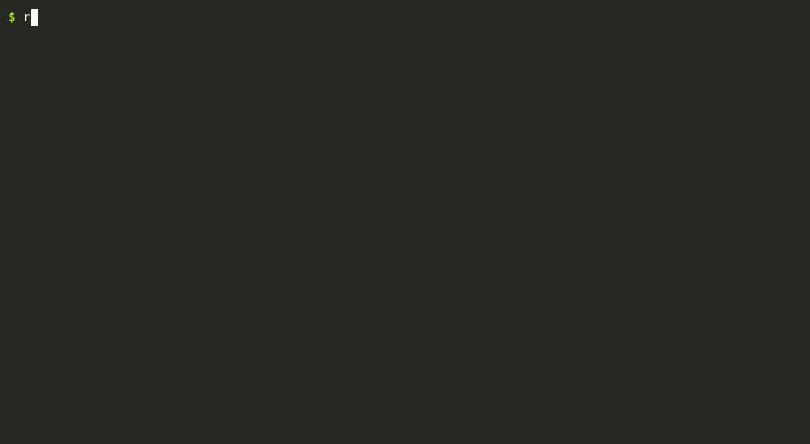

# rumpty-cli

Manage workspaces, VMs, and storage on [Rumpty Cloud](https://rumptycloud.com) from your terminal.



## Install

Install the latest release with the install script:

```sh
curl -fsSL https://get.rumptycloud.com | sh
```

The script downloads the release for your OS and architecture, verifies its checksum, and installs the `rumpty` binary to `/usr/local/bin` (falling back to `~/.local/bin` when that directory is not writable). It stops if the checksum is missing or does not match. If [cosign](https://docs.sigstore.dev/cosign/system_config/installation/) is installed, it also verifies the release signature and stops if the signature is missing or invalid.

Optional overrides:

```sh
# Install a specific version
curl -fsSL https://get.rumptycloud.com | RUMPTY_VERSION=v0.0.6 sh

# Install to a custom directory
curl -fsSL https://get.rumptycloud.com | RUMPTY_INSTALL_DIR="$HOME/.local/bin" sh
```

Verify the install:

```sh
rumpty --version
```

### Updates

Once a day, `rumpty` checks GitHub for a newer release and prints a one-line notice when it finds one. The notice only appears in a terminal, never in pipes, scripts or CI. Set `RUMPTY_NO_UPDATE_NOTIFIER=1` to turn it off.

### Verify a release

Releases from v0.0.8 on are signed by this repository's release workflow and come with build provenance and an SBOM for each archive. To check a download by hand, fetch the archive, `rumpty-cli_<version>_checksums.txt` and `rumpty-cli_<version>_checksums.txt.sigstore.json` from the [release page](https://github.com/cloverworks-hq/rumpty-cli/releases), then:

```sh
VERSION=0.0.12

# 1. The checksums file was signed by the release workflow for this tag
cosign verify-blob \
  --bundle "rumpty-cli_${VERSION}_checksums.txt.sigstore.json" \
  --certificate-identity "https://github.com/cloverworks-hq/rumpty-cli/.github/workflows/release.yml@refs/tags/v${VERSION}" \
  --certificate-oidc-issuer https://token.actions.githubusercontent.com \
  "rumpty-cli_${VERSION}_checksums.txt"

# 2. The archive matches the signed checksum
sha256sum --ignore-missing -c "rumpty-cli_${VERSION}_checksums.txt"   # macOS: shasum -a 256 --ignore-missing -c ...
```

Or check where an archive was built with the GitHub CLI:

```sh
gh attestation verify "rumpty-cli_${VERSION}_darwin_arm64.tar.gz" --repo cloverworks-hq/rumpty-cli
```

Releases v0.0.8 to v0.0.11 were signed before the organisation was renamed, so use `Sanmo-Labs/rumpty-cli` in the certificate identity for those.

Each archive's SBOM is published next to it as `<archive>.sbom.json` (SPDX).

## Quick Start

Sign in through your browser (stores a session for later commands):

```sh
rumpty login
```

The session, and the short-lived SSH keys `rumpty ssh` caches between runs, are stored in your OS keychain (macOS Keychain, Windows Credential Manager, or the Secret Service on Linux), with other settings in `~/.config/rumpty`. Without a keychain, as on most servers and CI runners, they are kept in `~/.config/rumpty` readable only by you. Set `RUMPTY_NO_KEYCHAIN=1` to always use the file.

For scripts and CI, pipe an API key to `rumpty login --token-stdin` or set `RUMPTY_API_KEY`.

SSH into a workspace VM:

```sh
rumpty ssh <vm>
```

Back up a local folder to object storage — the bucket is created automatically on first run, and repeat runs only transfer changes:

```sh
rumpty sync ~/sales-reports my-backups
```

Add `--watch` to keep syncing as files change, or `--daemon` to do the same in a background process (`rumpty sync status` / `rumpty sync stop` manage it). See the [docs](https://docs.rumptycloud.com/cli/introduction) for every command and flag.

## Commands

| Command | Description |
|---------|-------------|
| `login` / `logout` | Authenticate with Rumpty / remove the local session |
| `ssh` | Open an SSH session to a workspace VM |
| `sync` | Sync a local folder to a bucket in object storage |
| `copy` (alias `cp`) | Copy files between your machine and a VM |
| `exec` | Run a non-interactive command on a VM |
| `expose` / `unexpose` | Add or remove a public URL for a VM service |
| `vm` | Manage workspace VMs: `ls`, `start`, `stop`, `reboot`, `delete` |
| `load-balancer` (alias `lb`) | Put several VMs behind one HTTPS address: `ls`, `get`, `create`, `update`, `delete`, `add-target`, `remove-target` |
| `workspaces` | List workspaces you can access |
| `mcp` | Show how to connect Cursor, Claude Code, VS Code and other AI clients to Rumpty MCP; `mcp install <client>` writes the config for you |
| `completion` | Generate shell autocompletion script |

Use `rumpty [command] --help` for details on any command.

## Expose a VM Service

Expose a service running inside a VM with a public HTTPS URL:

```sh
rumpty expose <vm> --port <port> --name <name>
```

List exposed URLs for a VM:

```sh
rumpty vm expose ls <vm>
```

Remove an exposed URL:

```sh
rumpty unexpose <vm> --name <name>
```

The service inside the VM must listen on `0.0.0.0:<port>` so the VM network can reach it. A service bound only to `127.0.0.1:<port>` accepts connections from inside the VM itself, but not from the Rumpty HTTP route.

## Load Balancers

Spread HTTPS traffic across 1 to 10 VMs behind one address. Each load balancer costs $2/month, billed hourly until you delete it.

```sh
rumpty lb create web --vm web-1 --vm web-2 --port 8080 --health-path /healthz
rumpty lb ls
rumpty lb get web
rumpty lb add-target web web-3
rumpty lb remove-target web web-1
rumpty lb update web --sticky --allow 203.0.113.0/24
rumpty lb delete web
```

Use `--protocol grpc` for gRPC services; gRPC load balancers use TCP health checks. Every command waits until the change is live.

## Shell Completion

`rumpty` ships completion for subcommands and flags, plus dynamic completion of
live VM names and workspace slugs (`rumpty ssh <TAB>`, `rumpty vm stop <TAB>`,
`rumpty --ws <TAB>`).

Generate and install the completion script for your shell:

```sh
mkdir -p ~/.oh-my-zsh/completions
rumpty completion zsh > ~/.oh-my-zsh/completions/_rumpty
rm -f ~/.zcompdump*   # bust the completion cache once after adding a new script

rumpty completion zsh > "${fpath[1]}/_rumpty"

rumpty completion bash | sudo tee /etc/bash_completion.d/rumpty > /dev/null

rumpty completion fish > ~/.config/fish/completions/rumpty.fish
```

Restart your shell (or `exec zsh`) afterwards. Run `rumpty completion --help`
for per-shell details.

Dynamic VM/workspace completion calls the Rumpty API as you press `<TAB>`, so it
requires authentication (`rumpty login` or `$RUMPTY_API_KEY`). VM-name
completion also needs a workspace: it uses `--ws`/`--workspace`,
`$RUMPTY_WORKSPACE`, or your default workspace when none is set. If the API is
unreachable, completion fails quietly (no suggestions) instead of blocking the
prompt.

## Community

Questions, ideas or want to chat with the team and other users? Join us on [Discord](https://discord.gg/BnFdQrMBhC).

## Contributing

See [CONTRIBUTING.md](CONTRIBUTING.md) for how to build, test and send a pull request. Report security problems privately as described in [SECURITY.md](SECURITY.md).

## License

Apache License 2.0. See [LICENSE](LICENSE) and [NOTICE](NOTICE).
